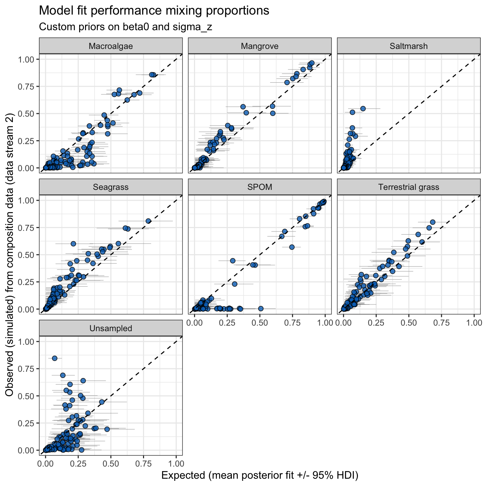

# Overview

By default, `run_mixmustr_models()` calls `build_stancode()` internally, so the
Stan program for each model variant is (re)generated and written to
`model_choices$code_path` every time models are run. This is convenient, but it
also means that any manual edits to those `.stan` files would be overwritten.

Advanced users may want to change parts of the Stan program, for example to use
more informative priors that reflect expert knowledge. This vignette
illustrates a workflow to do so:

1. Generate the standard Stan program with `build_stancode()`.
2. Edit the Stan code (here, two priors).
3. Fit the edited model with `run_mixmustr_models(..., build_code = FALSE)`,
   which skips `build_stancode()` and uses the `.stan` file as is.

We assume familiarity with the *Introduction to MixMustR* vignette.


``` r
library(MixMustR)
rstan::rstan_options(auto_write = TRUE)
options(mc.cores = parallel::detectCores())
```

---

## Step 1: Choose a model variant and generate its Stan code

We use the variant with fixed sampled-source signatures, a fixed
unsampled-source signature, and independent observations (row 6 of
`mixmustr_models`), which is the quickest to fit.


``` r
model_choice <- mixmustr_models[6, ]
model_choice
#>   sample_tracer fix_unsampled hierarchical
#> 6         FALSE          TRUE        FALSE
#>                                                             code_path
#> 6 stan/sample_tracer_FALSE_fix_unsampled_TRUE_hierarchical_FALSE.stan
```

Rather than using the default `code_path`, we point it to a new file so that
the customised program is kept separate from the standard ones. Note that the
file name (without extension) is also used as the Stan model name and as the
name of the corresponding element in the output of `run_mixmustr_models()`.
Here we use a temporary directory; in a real analysis you would typically use
a folder within your project.


``` r
stan_dir <- file.path(tempdir(), "mixmustr_stan")
dir.create(stan_dir, showWarnings = FALSE)
model_choice$code_path <- file.path(stan_dir, "custom_priors.stan")
```

Now generate the standard Stan program for this variant and write it to disk:


``` r
build_stancode(
  sample_tracer = model_choice$sample_tracer,
  fix_unsampled = model_choice$fix_unsampled,
  hierarchical = model_choice$hierarchical,
  code_path = model_choice$code_path
) |>
  invisible()
file.exists(model_choice$code_path)
#> [1] TRUE
```

The priors live in the `model` block. Let's print them:


``` r
stan_code <- readLines(model_choice$code_path)
model_start <- grep("^model \\{", stan_code)
prior_lines <- grep(" ~ ", stan_code)
prior_lines <- prior_lines[prior_lines > model_start]
cat(stan_code[prior_lines], sep = "\n")
#>   to_vector(z_raw) ~ std_normal();
#>   sigma_z ~ normal(0, 1);
#>   beta0 ~ normal(0, 1.5);
#>   log_sigma_y_raw ~ normal(0, 0.5);
#>   nu_rho ~ gamma(2, 0.1);
#>       ln_rho[n, j] ~ student_t(nu_rho, log_p_n[j], sigma_ln_rho[n, j]);
#>     Y[n] ~ normal(mu_n, sigma_n);
```

The last two lines are the stream-2 and stream-1 likelihoods; the remaining
ones are priors. For this variant:

* `beta0` are the baseline logits of each sampled source relative to the
  unsampled source (the reference category).
* `sigma_z` are the observation-level standard deviations of those logits.
* `log_sigma_y_raw` controls the residual tracer scale for data stream 1.
* `nu_rho` are the degrees of freedom of the Student-t likelihood for data
  stream 2.

---

## Step 2: Modify the Stan code

Suppose prior knowledge suggests that the mixing proportions of sampled
sources are unlikely to be very extreme relative to the unsampled source, and
that observation-level departures from those baseline logits should be small.
We tighten the prior on `beta0` and replace the half-normal prior on `sigma_z`
with an exponential prior.

The `.stan` file can be edited in any text editor. Here we do it
programmatically, checking that each line to be replaced is present exactly
once:


``` r
replacements <- c(
  "  beta0 ~ normal(0, 1.5);" = "  beta0 ~ normal(0, 1); // modified prior",
  "  sigma_z ~ normal(0, 1);" = "  sigma_z ~ exponential(2); // modified prior"
)
for (old in names(replacements)) {
  stopifnot(sum(stan_code == old) == 1)
  stan_code[stan_code == old] <- replacements[[old]]
}
writeLines(stan_code, model_choice$code_path)
```

It is good practice to check that the edited program still parses before
fitting it:


``` r
rstan::stanc(file = model_choice$code_path)$status
#> [1] TRUE
```

When editing the Stan code, keep in mind that:

* The `data` block must remain compatible with the data list produced by
  `mixmustr_wrangle_input()`. The `sample_tracer`, `fix_unsampled`, and
  `hierarchical` columns in `model_choice` must therefore match the variant
  the file was generated from.
* The post-processing functions (e.g., `make_post_prop_long()` and
  `mixmustr_bayes_R2()`) rely on the mixing-proportion matrix `p`, so it
  should not be renamed or removed.
* Tracer observations and source signatures are standardised by
  `mixmustr_wrangle_input()` before fitting, so priors on tracer-scale
  quantities apply on the standardised scale.

---

## Step 3: Fit the modified model

We now call `run_mixmustr_models()` with `build_code = FALSE`. This skips
`build_stancode()` so the edited file is not overwritten. If the file at
`code_path` did not exist, `run_mixmustr_models()` would stop with an
informative error.


``` r
model_fits <- run_mixmustr_models(
  model_choice, synthetic_df_convergent, tracer_parameters,
  sigma_ln_rho = 1, build_code = FALSE, iter = 2e3, warmup = 1e3,
  chains = 4, cores = 4
)
```

The output is named after the `.stan` file. We can confirm that the fitted
model used the modified priors:


``` r
names(model_fits)
#> [1] "custom_priors"
fit <- model_fits$custom_priors$model
fitted_code <- strsplit(rstan::get_stancode(fit), "\n")[[1]]
cat(grep("modified prior", fitted_code, value = TRUE), sep = "\n")
#>   sigma_z ~ exponential(2); // modified prior
#>   beta0 ~ normal(0, 1); // modified prior
```

And inspect the parameters whose priors were changed:


``` r
print(fit, pars = c("beta0", "sigma_z"), probs = c(0.025, 0.5, 0.975))
#> Inference for Stan model: custom_priors.
#> 4 chains, each with iter=2000; warmup=1000; thin=1; 
#> post-warmup draws per chain=1000, total post-warmup draws=4000.
#> 
#>             mean se_mean   sd  2.5%   50% 97.5% n_eff Rhat
#> beta0[1]    0.17    0.01 0.20 -0.23  0.18  0.54  1304 1.00
#> beta0[2]   -1.10    0.01 0.26 -1.61 -1.09 -0.61  1337 1.00
#> beta0[3]   -1.79    0.00 0.18 -2.16 -1.79 -1.45  2241 1.00
#> beta0[4]   -0.77    0.01 0.28 -1.33 -0.78 -0.23  1054 1.00
#> beta0[5]   -0.43    0.01 0.34 -1.09 -0.43  0.24   637 1.00
#> beta0[6]   -0.39    0.01 0.21 -0.78 -0.39  0.01  1568 1.00
#> sigma_z[1]  1.20    0.01 0.17  0.91  1.19  1.55   823 1.00
#> sigma_z[2]  2.07    0.00 0.18  1.75  2.06  2.46  1546 1.00
#> sigma_z[3]  0.50    0.01 0.27  0.03  0.50  1.00   471 1.01
#> sigma_z[4]  2.32    0.01 0.24  1.87  2.31  2.81  1103 1.00
#> sigma_z[5]  3.11    0.01 0.24  2.66  3.10  3.61   903 1.00
#> sigma_z[6]  1.38    0.00 0.16  1.08  1.37  1.70  1094 1.00
#> 
#> Samples were drawn using NUTS(diag_e) at Thu Oct 22 12:57:48 2026.
#> For each parameter, n_eff is a crude measure of effective sample size,
#> and Rhat is the potential scale reduction factor on split chains (at 
#> convergence, Rhat=1).
```

The fitted model can be used with all `MixMustR` post-processing tools, as
usual:


``` r
library(ggplot2)
make_post_prop_long(
  fit, tracer_parameters$mus, synthetic_df_convergent, target = "df_stream_2",
  n = 1
) |>
  plot_multiple_faceted_scatter_avg() +
  theme(legend.position = "none") +
  labs(
    y = "Observed (simulated) from composition data (data stream 2)",
    title = "Model fit performance mixing proportions",
    subtitle = "Custom priors on beta0 and sigma_z"
  )
```

<p align="center">
  
</p>


``` r
mixmustr_bayes_R2(
  fit, summary = TRUE, data_streams_list = synthetic_df_convergent,
  target = "df_stream_2", order_ref = tracer_parameters$mus$source
)
#>              Source mean 2.5%HDI 97.5%HDI
#> 1        Macroalgae 0.80    0.77     0.84
#> 2          Mangrove 0.93    0.90     0.96
#> 3         Saltmarsh 0.11    0.03     0.24
#> 4          Seagrass 0.81    0.75     0.87
#> 5              SPOM 0.90    0.89     0.92
#> 6 Terrestrial grass 0.85    0.79     0.90
#> 7         Unsampled 0.33    0.27     0.40
```

---

## Recap

1. Use `build_stancode()` with a custom `code_path` to generate the standard
   Stan program for the chosen variant.
2. Edit the `.stan` file (e.g., priors), keeping the `data` block and the
   mixing-proportion matrix `p` intact.
3. Fit with `run_mixmustr_models(..., build_code = FALSE)` so the edited file
   is used as is.
